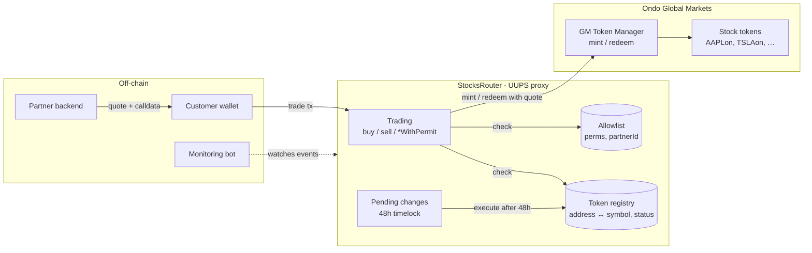
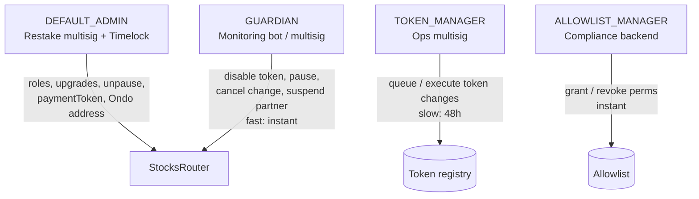
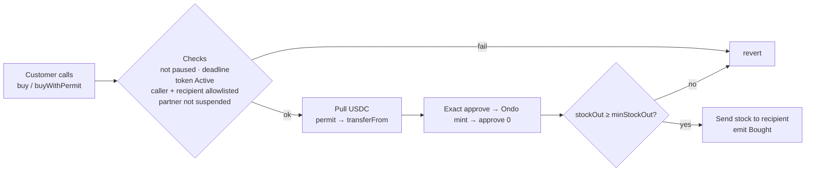
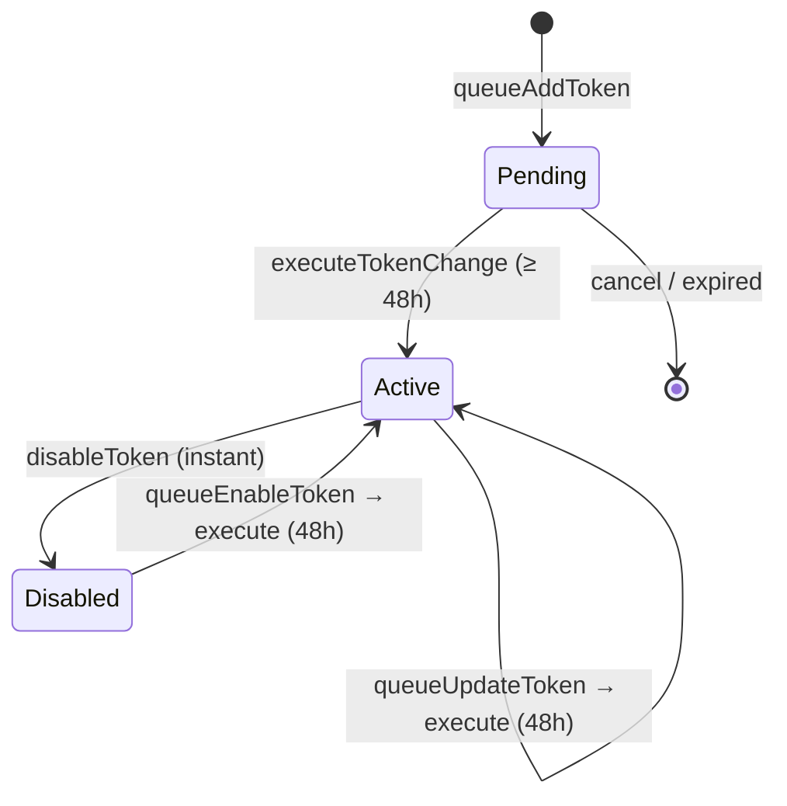

# Stocks Router

A single on-chain entry point that lets partners' customers **buy and sell Ondo Global Markets
tokenized stocks** (`AAPLon`, `TSLAon`, …) with a stablecoin. Only whitelisted tokens and
allowlisted accounts can trade.

> Status: **Draft / design.** The full specification is in [docs/architecture.md](docs/architecture.md).

---

## Key features

- **Token whitelist with symbol mapping.** Stock tokens are registered as `address ↔ symbol`, lookup works both ways, and each symbol is unique.
- **48h timelock on new capability.** Adding, updating or re-enabling a token is queued and can run only after 48h, within a 7-day window.
- **Instant defensive actions.** The guardian can disable a token, pause the router, cancel a queued change or suspend a partner immediately.
- **Account allowlist.** Buy and sell permissions are separate, each account is tagged with the partner that onboarded it, and a partner's customers can be suspended in one tx. **Both caller and recipient** are checked.
- **Gasless approvals.** `buyWithPermit` / `sellWithPermit` use EIP-2612. Permit failures fall back to the existing allowance, and Permit2 is the fallback for tokens without EIP-2612.
- **User protection.** Every trade has `minOut` slippage and `deadline` checks. Received amounts are measured as balance deltas.
- **No custody.** The router holds no funds between transactions. Approvals to Ondo are for the exact amount and are reset to 0 after each trade.
- **Hardened baseline.** OpenZeppelin role-based access with two-step admin transfer, `Pausable`, `ReentrancyGuard`, `SafeERC20`, a UUPS proxy behind a timelock, ERC-7201 storage, custom errors, and an event for every state change.

---

## Architecture overview

### System context



### Governance and roles



Rule of thumb: **adding capability is slow, removing it is fast.** The guardian can freeze the
system but cannot unfreeze it, which is admin-only. No role can move user funds.

### Trade flow (buy)



Sell is the mirror image: the router pulls the stock, redeems it through Ondo, checks `minAmountOut`, and pays the stablecoin to the recipient.

### Token lifecycle



---

## Components

| Component | Responsibility |
|---|---|
| `StocksRouter` | Entry point. Handles allowlist and registry checks, fund movement, slippage and deadline checks, and the Ondo calls |
| Token registry | Whitelist of stock tokens with symbol mapping and `Active` / `Disabled` status |
| Allowlist | Per-account buy and sell permissions plus partner attribution |
| Ondo adapter (`_ondoMint` / `_ondoRedeem`) | Isolates the Ondo GM interface, so changes on Ondo's side do not affect the rest of the router |
| Partner backend | Gets the Ondo quote off-chain and builds the customer's tx |
| Monitoring bot | Watches `TokenChangeQueued` and other events, and lets the guardian react within the 48h window |

## Planned repo layout

```
src/        StocksRouter.sol, interfaces/, libraries/
script/     Deploy.s.sol, SyncTokens.s.sol (diff config vs chain → queue txs)
config/     tokens.<chainId>.json
test/       unit/ fuzz/ invariant/ fork/
docs/       architecture.md
```

Tooling: Foundry, OpenZeppelin Contracts (Upgradeable) v5, and Slither in CI. An external audit is planned before mainnet.

## Further reading

- [docs/architecture.md](docs/architecture.md): storage layout, interfaces, ordered checks, permit handling, invariants, events and errors, and open questions.
