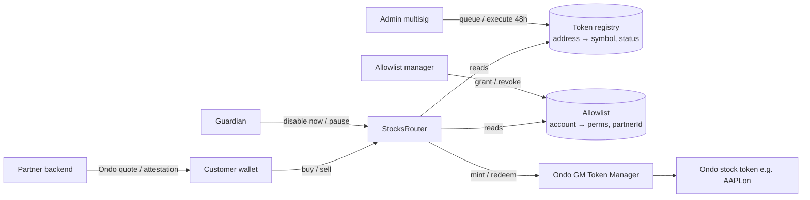
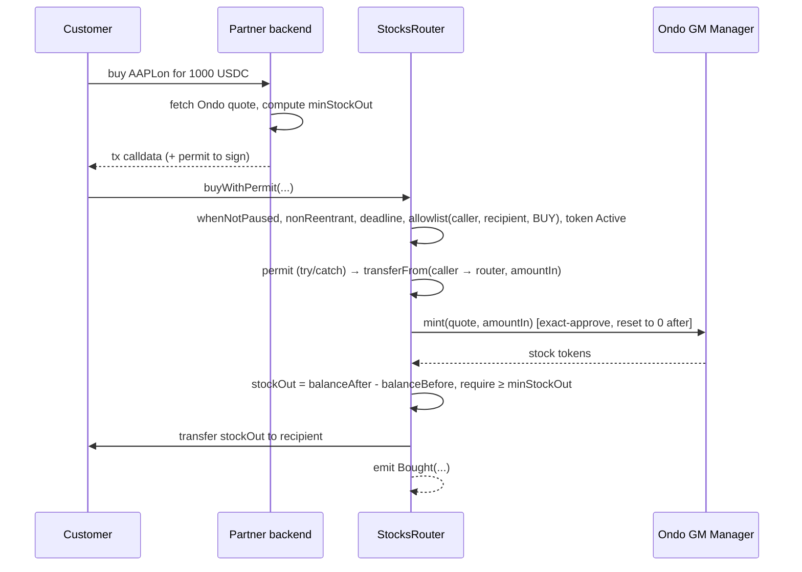

# Stocks Router — Architecture

Status: **Draft / design** · Owner: Restake · Last updated: 2026-11-13

## 1. Purpose

`StocksRouter` is a single on-chain entry point. It lets **our partners' customers** buy and sell
**Ondo Global Markets tokenized stocks** (e.g. `AAPLon`, `TSLAon`) with a stablecoin.

The router:

- accepts only **whitelisted stock tokens**, each identified by address and symbol;
- accepts only **allowlisted accounts**, with separate permissions to buy and to sell;
- offers `buy` / `buyWithPermit` and `sell` / `sellWithPermit`;
- lets admins **add or update** tokens only after a **48h delay**, and lets them **disable** a token **immediately**;
- follows a standard security baseline: roles, pause, reentrancy guard, slippage and deadline checks, and no leftover funds.

Out of scope for v1: partner fees, multi-hop swaps, cross-chain, corporate actions (dividends and splits are handled by Ondo at the token level).

---

## 2. High-level components



| Component | Responsibility |
|---|---|
| `StocksRouter` | Moves user funds, checks the allowlist and registry, calls Ondo, enforces slippage and deadline |
| Token registry (in router storage) | Whitelist `token address ↔ symbol` plus status. Changes go through the timelock (except disable) |
| Allowlist (in router storage) | Who may buy or sell, tagged with the partner they came through |
| Ondo GM Token Manager | Mints and redeems stock tokens against stablecoin using a signed quote (attestation) |
| Partner backend | Gets the Ondo quote off-chain and builds the tx for the customer |

> **To verify with Ondo:** the exact mint/redeem interface (function names, quote struct, which
> stablecoins are accepted: USDC / USDon). Also whether quotes are bound to `msg.sender` (= router)
> or to the end user. And whether the **router address itself** must be on Ondo's own allowlist or
> KYC list. The router hides this behind one internal adapter (`_ondoMint` / `_ondoRedeem`), so the
> answers do not change the rest of the design.

---

## 3. Roles & access control

Built on OpenZeppelin `AccessControlDefaultAdminRules`. Admin transfer takes two steps and has its own delay.

| Role | Holder | Can do |
|---|---|---|
| `DEFAULT_ADMIN_ROLE` | Restake multisig (Safe) | Grant/revoke roles, set `paymentToken`, `unpause`, authorize upgrades |
| `TOKEN_MANAGER_ROLE` | Ops multisig | `queueAddToken`, `queueUpdateToken`, `executeTokenChange`, `cancelTokenChange` |
| `GUARDIAN_ROLE` | Hot-ish key / monitoring bot + multisig | `disableToken` (**instant**), `pause`, `cancelTokenChange`, `suspendPartner` |
| `ALLOWLIST_MANAGER_ROLE` | Restake compliance backend | `setAllowlist`, `setAllowlistBatch`, `removeFromAllowlist` |

Principles:

- **Defensive actions are fast; actions that add capability are slow.** The guardian can disable, pause or cancel at once. Adding, updating or re-enabling a token always waits 48h.
- **Unpause is admin-only.** If the guardian key is compromised, the attacker can only freeze the system, never unfreeze or extend it.
- No role can move user funds. No arbitrary `call` or `delegatecall` exists anywhere.

---

## 4. Token registry (whitelist with symbol mapper)

### 4.1 Storage

```solidity
enum TokenStatus { None, Active, Disabled }

struct TokenConfig {
    string      symbol;      // e.g. "AAPLon" — unique
    TokenStatus status;
    uint8       decimals;    // cached at add time, sanity-checked against token
}

mapping(address token => TokenConfig) public tokens;        // address → config
mapping(bytes32 symbolHash => address) public tokenBySymbol; // keccak256(symbol) → address
address[] internal _tokenList;                               // enumeration for UIs / scripts
```

- Lookup works in both directions: `tokens(addr).symbol` and `getTokenBySymbol("AAPLon")`.
- The symbol is unique. Adding a duplicate reverts with `SymbolTaken`.
- `getTokens()` returns `(address[] addrs, TokenConfig[] cfgs)` for frontends and partners.

### 4.2 Timelocked changes (48h)

```solidity
uint256 public constant TOKEN_CHANGE_DELAY = 48 hours;
uint256 public constant TOKEN_CHANGE_GRACE = 7 days;   // queued op expires after eta + grace

enum ChangeKind { Add, Update, Enable }

struct PendingChange {
    ChangeKind kind;
    string     symbol;
    uint64     eta;     // block.timestamp + TOKEN_CHANGE_DELAY
}

mapping(address token => PendingChange) public pendingChanges; // one pending op per token
```

| Action | Who | Delay | Notes |
|---|---|---|---|
| `queueAddToken(token, symbol)` | TOKEN_MANAGER | queue now, execute ≥ 48h | Token must be `None`. Symbol must not be taken or pending |
| `queueUpdateToken(token, newSymbol)` | TOKEN_MANAGER | 48h | Re-maps the symbol. The old symbol hash is released on execute |
| `queueEnableToken(token)` | TOKEN_MANAGER | 48h | Re-enabling a disabled token counts as adding capability, so it waits too |
| `executeTokenChange(token)` | TOKEN_MANAGER | `eta ≤ now ≤ eta + grace` | Applies the change and deletes the pending entry |
| `cancelTokenChange(token)` | TOKEN_MANAGER or GUARDIAN | instant | |
| `disableToken(token)` | GUARDIAN (or TOKEN_MANAGER) | **instant** | Sets `Disabled`. Buy and sell revert at once. Also cancels any pending change for that token |

Notes:

- **Disable blocks both buy and sell** (decided). It is an emergency switch (wrong address, Ondo incident, delisting). If we later want sell-only wind-down, we can add a `SellOnly` status without changing storage layout.
- Tokens are never deleted. This keeps the history and `_tokenList` stable.
- A queued change records its parameters. Execute applies exactly what was queued, so there is no "queue A, execute B".

### 4.3 Off-chain config

Deploy scripts read a per-chain JSON. The contract stays the source of truth, and a script diffs the JSON against on-chain state and prints the `queue*` txs for the multisig.

```json
// config/tokens.<chainId>.json
{
  "paymentToken": { "symbol": "USDC", "address": "0x..." },
  "ondoTokenManager": "0x...",
  "stocks": [
    { "symbol": "AAPLon", "address": "0x..." },
    { "symbol": "TSLAon", "address": "0x..." }
  ]
}
```

---

## 5. Allowlist (who can buy / sell)

```solidity
uint8 constant PERM_BUY  = 1 << 0;
uint8 constant PERM_SELL = 1 << 1;

struct AllowEntry {
    uint8  perms;      // bitmask of PERM_*
    uint32 partnerId;  // which partner onboarded this customer (attribution + bulk suspend)
}

mapping(address account => AllowEntry) public allowlist;
mapping(uint32 partnerId => bool) public partnerSuspended;
```

- `setAllowlist(account, perms, partnerId)` and `setAllowlistBatch(...)` are for ALLOWLIST_MANAGER. They take effect **immediately**, because compliance has to be able to revoke at once.
- `suspendPartner(partnerId, bool)` is for GUARDIAN or ALLOWLIST_MANAGER. It switches off all customers of one partner in a single tx.
- Check performed on each trade:
  `hasPerm(caller, PERM_X) && hasPerm(recipient, PERM_X) && !partnerSuspended[...]`.
  **The recipient is checked too.** Otherwise an allowlisted account could relay stocks to anyone.
- This allowlist is **ours**. Ondo still applies its own transfer restrictions (sanctions, jurisdiction) inside the stock tokens. Our list is a subset of what Ondo permits, not a replacement for it.

---

## 6. Trading flows

### 6.1 Interface

```solidity
struct OndoQuote { bytes data; bytes signature; } // opaque; shape pinned once Ondo interface confirmed

function buy(
    address stock,
    uint256 amountIn,        // payment token amount
    uint256 minStockOut,     // slippage guard
    address recipient,
    uint256 deadline,
    OndoQuote calldata quote
) external returns (uint256 stockOut);

function buyWithPermit(
    address stock, uint256 amountIn, uint256 minStockOut, address recipient, uint256 deadline,
    OndoQuote calldata quote,
    uint256 permitDeadline, uint8 v, bytes32 r, bytes32 s   // EIP-2612 on paymentToken
) external returns (uint256 stockOut);

function sell(
    address stock,
    uint256 stockIn,
    uint256 minAmountOut,    // payment token out
    address recipient,
    uint256 deadline,
    OndoQuote calldata quote
) external returns (uint256 amountOut);

function sellWithPermit(
    address stock, uint256 stockIn, uint256 minAmountOut, address recipient, uint256 deadline,
    OndoQuote calldata quote,
    uint256 permitDeadline, uint8 v, bytes32 r, bytes32 s   // EIP-2612 on stock token
) external returns (uint256 amountOut);
```

The `*WithPermit` variants call an internal `_permit(token, ...)` and then share code with the plain variants. There is a single `_buy` and a single `_sell` implementation.

### 6.2 Buy sequence



Sell mirrors this. The router pulls the stock, redeems through Ondo, measures the stablecoin received, checks `minAmountOut`, and pays `recipient`.

### 6.3 Ordered checks (both directions)

1. `whenNotPaused`, `nonReentrant`
2. `block.timestamp <= deadline`
3. `amount > 0`, `recipient != address(0)`
4. `tokens[stock].status == Active`
5. Allowlist: caller **and** recipient have the permission, and their partner is not suspended
6. Pull funds (`SafeERC20.safeTransferFrom`). Measure the amount actually received as a **balance delta**
7. `forceApprove(ondo, exact)` → call Ondo → `forceApprove(ondo, 0)`
8. Measure output as a balance delta and require `>= minOut`
9. Transfer the output to `recipient` and emit the event

### 6.4 Permit handling

- Wrap `permit` in `try/catch`. If it reverts, continue when `allowance >= amount` already. This defends against **permit front-running griefing**, where someone submits the user's signature first and makes the user's tx revert.
- `permit` uses its own `permitDeadline`, separate from the trade `deadline`.
- Not every token implements EIP-2612 (USDT on Ethereum does not). For those, use plain `buy` after an `approve`. Whether the Ondo stock tokens implement EIP-2612 **must be confirmed**. If they do not, `sellWithPermit` falls back to Uniswap **Permit2** (`permitTransferFrom`). The interface stays the same and only `_permit` changes.

---

## 7. Security baseline

| Area | Measure |
|---|---|
| Access | OZ `AccessControlDefaultAdminRules`: two-step admin transfer with delay, separate roles (§3) |
| Emergency | `Pausable`: the guardian pauses, only the admin unpauses. Instant `disableToken` and `suspendPartner` |
| Timelock | 48h on token add/update/enable, with a 7-day expiry window. Role grants and upgrades go through OZ `TimelockController` (48h) owned by the admin multisig |
| Reentrancy | `ReentrancyGuard` (transient variant on chains with EIP-1153) on all trade functions. CEI ordering |
| Token handling | `SafeERC20` everywhere, balance-delta accounting, `forceApprove` of the exact amount and reset to 0 afterwards. No infinite approvals to external contracts |
| User protection | `minOut` + `deadline` on every trade. Recipient is checked against the allowlist |
| No custody | The router keeps no balances between txs (invariant). `rescueTokens(token, to, amount)` is admin-only and covers accidental transfers only |
| No arbitrary calls | The Ondo manager address is fixed in storage and changed only by an admin through the timelock. No user-supplied call targets |
| Upgradeability | UUPS proxy. `_authorizeUpgrade` is gated by `DEFAULT_ADMIN_ROLE` (= timelock). Uses ERC-7201 namespaced storage. `_disableInitializers()` in the constructor |
| Errors / events | Custom errors. An event for every state change (`TokenChangeQueued/Executed/Cancelled`, `TokenDisabled`, `AllowlistUpdated`, `PartnerSuspended`, `Bought`, `Sold`, `Paused`…) so monitoring can alert |
| Monitoring | Off-chain bot watches `TokenChangeQueued`. If a change is unexpected, the guardian cancels it inside the 48h window |

### 7.1 Invariants (to be fuzz / invariant-tested)

1. After any external call returns, `paymentToken.balanceOf(router) == 0` and `stock.balanceOf(router) == 0` for every stock.
2. A trade succeeds only if the token is `Active`, caller and recipient hold the permission, the partner is not suspended, and the router is not paused.
3. A token can become `Active` only through `executeTokenChange` at least 48h after the change was queued.
4. `tokenBySymbol[keccak(tokens[t].symbol)] == t` for every registered `t`, and no symbol maps to two tokens.
5. The router's allowance to Ondo is 0 outside a trade.

---

## 8. Events & errors (sketch)

```solidity
event TokenChangeQueued(address indexed token, ChangeKind kind, string symbol, uint64 eta);
event TokenChangeExecuted(address indexed token, ChangeKind kind, string symbol);
event TokenChangeCancelled(address indexed token);
event TokenDisabled(address indexed token, address indexed by);
event AllowlistUpdated(address indexed account, uint8 perms, uint32 indexed partnerId);
event PartnerSuspended(uint32 indexed partnerId, bool suspended);
event Bought(address indexed caller, address indexed recipient, address indexed stock,
             uint256 amountIn, uint256 stockOut, uint32 partnerId);
event Sold  (address indexed caller, address indexed recipient, address indexed stock,
             uint256 stockIn, uint256 amountOut, uint32 partnerId);

error NotAllowlisted(address account, uint8 perm);
error PartnerIsSuspended(uint32 partnerId);
error TokenNotActive(address token);
error SymbolTaken(string symbol);
error ChangeAlreadyPending(address token);
error ChangeNotReady(uint64 eta);
error ChangeExpired(uint64 eta);
error NoPendingChange(address token);
error DeadlineExpired();
error InsufficientOutput(uint256 out, uint256 minOut);
error ZeroAmount();
error ZeroAddress();
```

---

## 9. Proposed repo layout

```
src/
  StocksRouter.sol
  interfaces/IStocksRouter.sol
  interfaces/IOndoGMTokenManager.sol   # pinned to Ondo's real ABI
  libraries/Permissions.sol
script/
  Deploy.s.sol
  SyncTokens.s.sol                     # diff config/*.json vs chain → print queue txs
config/
  tokens.<chainId>.json
test/
  unit/  fuzz/  invariant/  fork/      # fork tests against live Ondo contracts
docs/
  architecture.md
```

Tooling: Foundry, OpenZeppelin Contracts (Upgradeable) v5, Slither in CI, an external audit before mainnet.

---

## 10. Open questions

1. **Ondo integration:** primary mint/redeem with an attestation, or secondary DEX liquidity, or both? Are quotes bound to the router or to the user? Is the router address required on Ondo's allowlist?
2. **Payment token:** USDC only, or several stablecoins (would make `paymentToken` a whitelisted set too)?
3. **Fees:** do partners or Restake take a fee in the router? Adding it later changes events and the math.
4. ~~**Disable semantics:** should a disabled token still allow `sell` so users can exit?~~ **Decided:** no. Disable blocks both buy and sell (see §4.2).
5. **Allowlist granularity:** are per-partner permissions enough, or is a per-jurisdiction flag also needed?
6. **Chains:** Ethereum only, or also BNB / other chains where Ondo GM is deployed? This affects permit support and the config.
